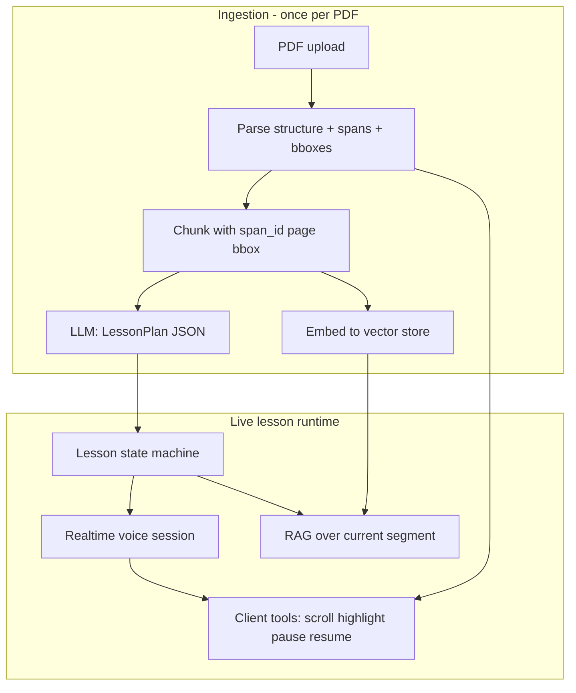
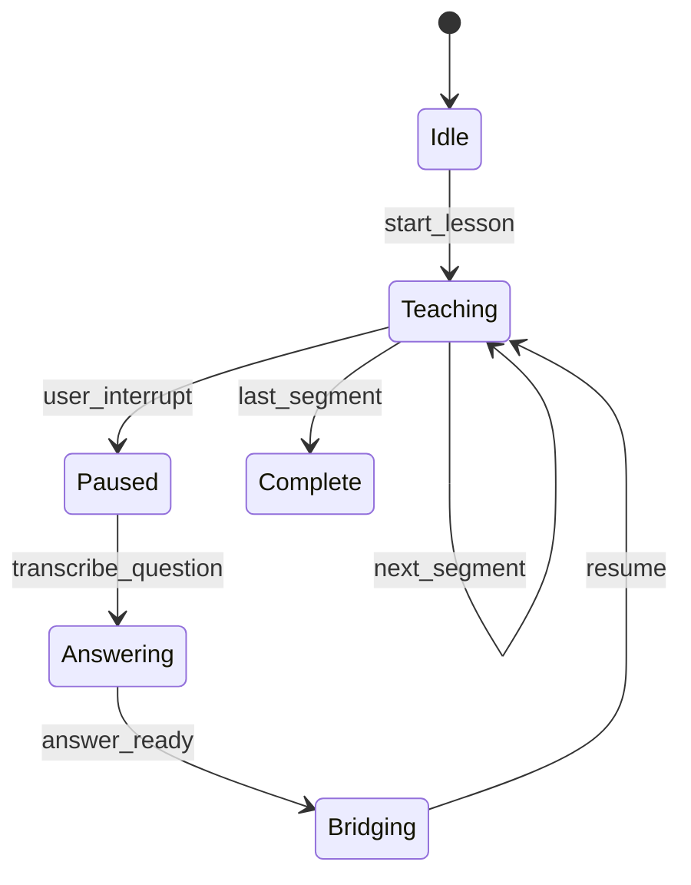

# Custom PDF Voice Lesson: LLM Workflow & Technical Feasibility

Research notes on a custom PDF viewer where class material is uploaded, an LLM delivers a voice lesson, scrolls/highlights the PDF in sync, and supports interruptible Q&A with resume.

## Short answer

This is **very buildable for an MVP**, but the **full vision** (tight voice ↔ highlight ↔ scroll sync, clean interrupt/resume, and grounded teaching) is **moderately hard**. The hard part is usually **not** “can the LLM explain the PDF?” — it’s **orchestration**: structured lesson state, PDF span coordinates, and real-time voice with barge-in.

People have already shipped close cousins:

- [LearnAloud](https://devpost.com/software/learnaloud-4qgti9) — voice + live PDF highlights
- [TeachBack](https://devpost.com/software/live_teacher) — Gemini Live + interruption sidecar
- [Vaani](https://github.com/Rudra1729/Vaani) — grounded answers + auto-scroll/highlight
- Academic work on “smart textbooks” with in-context highlighting — [arxiv 2501.03618](https://arxiv.org/html/2501.03618)

---

## What’s easy vs hard

| Layer | Difficulty | Why |
|--------|------------|-----|
| Upload PDF + chat about it (RAG) | Easy | Chunk, embed, retrieve — standard pattern (e.g. [ai-pdf-tutor](https://github.com/dsnehitha/ai-pdf-tutor)) |
| Custom viewer + scroll to page | Easy–medium | [PDF.js](https://mozilla.github.io/pdf.js/) text layer + viewport scroll ([Stack Overflow pattern](https://stackoverflow.com/questions/27830725/add-html-css-overlays-by-text-location-on-pdf-document-when-rendering-in-pdf-js)) |
| Highlight exact phrases | **Medium–hard** | Need stable **span IDs + bounding boxes** per chunk; scanned PDFs need OCR |
| LLM delivers a **structured lesson** (not rambling chat) | Medium | Prompting + JSON schema / tool calls |
| **Voice** lesson | Medium | TTS/STT or a realtime voice API |
| **Sync** highlight with speech | **Hard** (polish) | LearnAloud calls out [sub-200ms sync](https://devpost.com/software/learnaloud-4qgti9) as the core challenge |
| **Interrupt → Q&A → resume** with context | **Medium–hard** | State machine + barge-in ([Gemini Live](https://ai.google.dev/gemini-api/docs/live-api), [OpenAI Realtime](https://developers.openai.com/api/docs/guides/voice-agents)) |
| Fold Q&A back into the lesson | Medium | Update `LessonPlan` / checkpoint, don’t rely on chat memory alone |

**Rough effort (experienced team):**

- **Demo (2–4 weeks):** scripted lesson, coarse page-level highlights, push-to-talk Q&A, resume from checkpoint.
- **Product-feel (2–4 months):** span-level highlights, smooth voice sync, reliable interrupts, multi-PDF, grounding checks.

---

## Recommended architecture (two tracks)

Split **offline preparation** from **live runtime**. The LLM workflow lives mostly in prep + a small runtime state machine.



### 1. Ingestion (before any lesson)

**Goal:** every teachable unit maps to **viewer actions**, not just text.

1. **Parse PDF** → pages, headings, paragraphs, figures (Docling, PyMuPDF, or pdf.js extraction).
2. For each text block, store:
   - `span_id`, `page`, `char_range` or quote,
   - `bbox` (PDF coords → screen via viewport),
   - optional `section_path` (“Chapter 2 / Mitosis”).
3. **Chunk for RAG** — but chunks must **reference `span_id`s**, not loose text only (same idea as Jill Watson keyword → highlight in [2501.03618](https://arxiv.org/html/2501.03618)).
4. **LLM pass: `LessonPlan`** (batch, cheap model is fine):

```json
{
  "title": "...",
  "segments": [
    {
      "id": "seg_01",
      "goal": "Define osmosis",
      "span_ids": ["p3_s12", "p3_s13"],
      "narration": "We'll start with the cell membrane...",
      "on_enter": { "scroll_to": "p3_s12", "highlights": ["p3_s12", "p3_s13"] },
      "check_question": "optional micro-check",
      "next": "seg_02"
    }
  ],
  "open_loops": []
}
```

This is the main **LLM workflow for content**: not one long monologue, but **segments** with explicit PDF anchors and narration script.

### 2. Live delivery (runtime LLM workflow)

Think **director + actor**, not one endless chat:

| Mode | LLM job | PDF / voice |
|------|---------|-------------|
| **TEACH** | Follow current segment; may lightly rephrase `narration` | Fire `on_enter` → scroll + highlight; stream TTS |
| **INTERRUPTED** | Answer question with RAG on `span_ids` + segment context | Pause highlights/TTS; optional temp highlight on cited spans |
| **BRIDGE** | 1–2 sentences linking answer → next segment | Update `open_loops` if user asked something you’ll revisit |
| **RESUME** | Continue from checkpoint | Clear temp state; restore segment highlights |

**Checkpoint state** (persist in Redis/DB, not only in the model):

```text
lesson_id, segment_id, offset_ms?, interrupt_stack[],
user_notes[], segments_completed[], pending_revisit[]
```

After a question, a small LLM call (or tool) does:

- `resolve_interrupt(question) → { answer, cite_span_ids, revisit_in_segment?: id }`
- `merge_into_lesson(open_loops, revisit_queue)`
- `resume_from(segment_id, rewind_seconds?: 0)`

[TeachBack](https://devpost.com/software/live_teacher) describes this pattern explicitly: main session pauses, correction flow runs, resolved context feeds back.

### 3. Voice + interrupt (implementation choice)

**Option A — Realtime voice API (recommended for barge-in)**

[Gemini Live](https://ai.google.dev/gemini-api/docs/live-api) and [OpenAI Realtime / voice agents](https://developers.openai.com/api/docs/guides/voice-agents) support **barge-in**, tool calls, and transcripts. **Client tools** are the glue:

- `go_to_span(span_id)`
- `set_highlights(span_ids[])`
- `pause_lesson()` / `resume_lesson(checkpoint)`
- `get_segment_context()` → returns narration + spans for RAG

The model doesn’t “draw on the PDF”; it **emits tool calls** your React app executes — same idea as LearnAloud’s “client actions embedded in LLM responses.”

**Option B — Pipeline (STT → LLM → TTS)**

More control, cheaper, easier to debug; **worse** interrupt feel unless you add VAD and cancel TTS aggressively ([Groq Whisper + Edge TTS pattern](https://github.com/harshagarwalnyu/HackNYU-Agora)).

For a **button to interrupt** (not only voice barge-in), you still want explicit `pause_lesson()` on click plus optional realtime VAD for “talk over the tutor.”

### 4. Speech ↔ highlight sync (the fiddly part)

Pragmatic staging:

1. **MVP:** highlight **whole segment** when TTS **starts** that segment; scroll once per segment. Good enough for class material.
2. **V1:** split `narration` into **clauses** each tagged with `span_id`; queue highlights on clause boundaries (timestamps from TTS word timing or estimated WPM).
3. **V2:** pre-compute a **speech timeline** + annotation triggers ahead of playback ([LearnAloud approach](https://devpost.com/software/learnaloud-4qgti9)).

PDF side: overlays after `textlayerrendered`, bbox highlights — well-trodden with [PDF.js + portals](https://www.nutrient.io/blog/pdfjs-rendering-overlays-react-portals/) and libraries like [react-pdf-highlighter](https://github.com/agentcooper/react-pdf-highlighter).

---

## LLM workflow as a state machine (LangGraph-style)

Even without LangGraph, model this explicitly ([Agora uses LangGraph for pedagogy states](https://github.com/harshagarwalnyu/HackNYU-Agora)):



**Nodes (each can be a small prompt + tools):**

- `segment_narrator` — stays on-script, calls highlight tools
- `qa_grounded` — RAG + must return `cite_span_ids` (refuse if no grounding)
- `lesson_editor` — optional: inserts a “revisit” mini-segment later
- `safety/grounding` — async check claims vs chunks (TeachBack-style background grounding)

---

## Biggest risks (and mitigations)

1. **Hallucinated teaching** → segment scripts + mandatory citations; show highlights only for retrieved spans.
2. **Bad PDF alignment** → ingestion QA UI (“click span, verify box”); fall back to page-level.
3. **Interrupt loses the thread** → checkpoints + `open_loops` in structured state, not chat history.
4. **Latency** → prep `LessonPlan` offline; runtime only narrates/adapts one segment at a time.
5. **Cost** → batch plan generation; smaller model for Q&A; realtime only during live lesson.

---

## What to build first (hackathon → product)

1. PDF viewer + span highlighting from pre-parsed JSON.
2. One-button **“Teach this chapter”** → loads cached `LessonPlan`.
3. TTS reads `narration`; on each segment, scroll + highlight.
4. **Hold to ask** → pause, STT question, grounded answer with highlights, **Resume** continues same `segment_id`.
5. Then swap TTS pipeline for **Gemini Live or Realtime** when interrupt quality matters.

---

## Bottom line

- **Technically feasible:** yes; prior art is strong in the last 12–18 months.
- **Hardest slice:** PDF span grounding + **perceived** voice/visual sync + clean interrupt/resume **state**, not raw LLM capability.
- **LLM workflow shape:** **offline `LessonPlan` with anchored segments** + **runtime state machine** (teach / interrupt / answer / bridge / resume) + **client tools** that own the PDF viewer.
